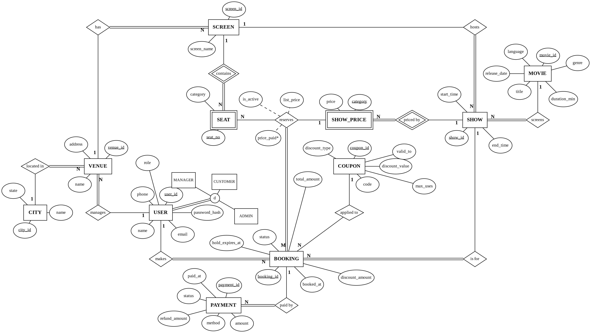

# CineBook: Movie Ticket Booking System

**CS F212 Database Systems (Sem 1, 2026-27), BITS Pilani, Hyderabad Campus | Group-17 | Mid-Sem Submission**

CineBook is a full-stack, database-backed movie ticket booking system in the style of BookMyShow. Customers search shows, hold seats, pay and cancel; venue managers schedule shows and set prices; admins view revenue and occupancy dashboards. The focus of the project is relational database design and DBMS-level integrity (for example, a seat can never be sold twice, enforced by the database itself). The application layer exists to demonstrate the design.

## Team

| Member | Student ID | Contribution up to mid-sem |
|---|---|---|
| Pratham Singla | 2024A8PS0486H | Core database design: ER/EER model, relational mapping, keys and integrity constraints, normalization, design justification, booking transaction and concurrency design |
| Harinandha L | 2024A4PS0660H | Requirements analysis, users, assumptions and business rules |
| Imran Hafeez S | 2024A4PS0690H | Application design: workflows, technology stack, architecture |
| Arjun Rathore | 2024A4PS0691H | GitHub repository setup, README, data-population plan |
| Sushanth Reddy Kompally | 2024A8PS0459H | Planned SQL queries, views and reporting design for the admin dashboard |

## Current Progress (Mid-Sem)

| Item | Status |
|---|---|
| Requirements, assumptions, business rules | Done |
| ER/EER model and relational mapping | Done |
| Integrity constraints, normalization, design justification | Done |
| Application design, technology stack, architecture | Done |
| DDL scripts, triggers, procedures, seed data | Planned |
| Backend (REST API) and front end | Planned |

The full design document (5 pages) is in [`docs/CineBook_MidSem_Report.pdf`](docs/CineBook_MidSem_Report.pdf).

## Database Design Summary



The diagram is a conceptual ER/EER model in Chen notation (foreign keys are not drawn). USER is specialised into CUSTOMER, MANAGER and ADMIN and mapped to one table with a `role` attribute. The ternary relationship `reserves` (BOOKING M, SEAT N, SHOW_PRICE 1) carries `list_price`, `price_paid` and `is_active`, and is mapped to the relation `booking_seat`.

**13 relations:** `app_user`, `city`, `venue`, `screen`, `seat` (weak), `movie`, `movie_show`, `show_price` (weak), `coupon`, `booking`, `booking_seat`, `payment`, `booking_audit`. The tables are named `app_user` and `movie_show` because USER and SHOW are reserved words.

**Key integrity decisions**

- **No double booking:** a partial unique index on `booking_seat (show_id, screen_id, seat_no) WHERE is_active`. Cancelled or expired bookings keep their history but free the seat.
- **Consistency across relations:** four composite foreign keys in `booking_seat` guarantee that the booking, the show, the seat (with its category) and the show's price for that category all match.
- **No overlapping shows:** an exclusion constraint on `movie_show` (same screen, overlapping time range), using PostgreSQL's `btree_gist` extension.
- **Pricing and discounts:** each reserved seat stores `list_price`, a snapshot of the show's price for the seat's category. The coupon discount is computed when the coupon is applied (`booking.discount_amount`, and `total_amount` is the amount payable). `price_paid` stays NULL until payment succeeds, then `CHECK (0 <= price_paid <= list_price)`. Refunds are recorded in `payment.refund_amount`.
- **Domain rules:** `PRIMARY KEY`, `FOREIGN KEY`, `UNIQUE`, `NOT NULL` and `CHECK` constraints on roles, statuses, prices, durations and time order. Rules a CHECK cannot express (1 to 6 seats per booking, manager role, audit log, confirmation rule) use triggers and a booking procedure.
- **Normalization:** the write model is normalized. The documented exceptions are `booking_seat` (repeats `show_id` and `screen_id` so the double-booking rule is enforced declaratively) and the sale-time snapshot columns. `total_amount` is derived. Details are in Section 6 of the PDF.

### Read-path design (API performance)

Showing one ticket should not need joins across user, booking, booking seat, seat, show, movie and venue. So `booking_seat` is a self-contained ticket line (seat number, category, list price, price paid), and `booking` stores a write-once snapshot of the show details (`movie_title`, `venue_name`, `screen_name`, `show_start`), like an invoice. The user comes from the JWT. Ticket detail is then one primary-key lookup plus one small range scan, and "my bookings" is one index scan on `(user_id, booked_at DESC)` with no joins. Joins and aggregates are reserved for admin reports. The final submission will compare `EXPLAIN ANALYZE` of the naive join and the snapshot query.

## Application Design

Architecture: **Front End <-> Backend <-> PostgreSQL**. Business-critical rules live in the database (constraints, triggers, procedures); the backend orchestrates transactions.

| Layer | Technology (proposed) |
|---|---|
| Front end | React with Vite |
| Backend | Node.js with Express, REST API, JWT authentication, bcrypt, node-postgres (parameterised SQL, no ORM) |
| Database | PostgreSQL 16 (`btree_gist` extension) |
| Tooling | Docker Compose, Python Faker for sample data, Git/GitHub |

### Planned workflows

1. **Book tickets (transaction):** search shows, choose seats, hold (list price copied from the show's price), apply coupon, pay, confirm (`price_paid` set). Rollback if payment fails; cancellation with refund as an extension.
2. **Admin analytics (complex retrieval):** revenue per venue per month, occupancy per show, top movies per city and peak booking hours, using joins, aggregation, subqueries, CTEs and views.
3. **Schedule show / invalid operations (constraint enforcement):** an overlapping show, a double booking, more than 6 seats, a bad price and an expired coupon are attempted and rejected by the DBMS.

### Planned DBMS features

Transactions, triggers (audit log, seat-count rule, manager-role check), views (show availability, revenue summary), indexes with an `EXPLAIN ANALYZE` before/after comparison, and a stored procedure for cancellation and refund.

## Repository Layout

```
.
|-- README.md
|-- docs/
|   |-- CineBook_MidSem_Report.pdf
|   `-- er_diagram.png
|-- db/            # schema, triggers, procedures, seed scripts (to be added)
|-- backend/       # Express API (to be added)
`-- frontend/      # React app (to be added)
```

## Setup and Run

Setup and run instructions will be added with the final submission.

## Timeline

| Date | Milestone |
|---|---|
| 11 Oct 2026 | Mid-sem submission (design document, application design, repository) |
| 15 Nov 2026 | Final submission |
| 17-19 Nov 2026 | Final demo and viva |
