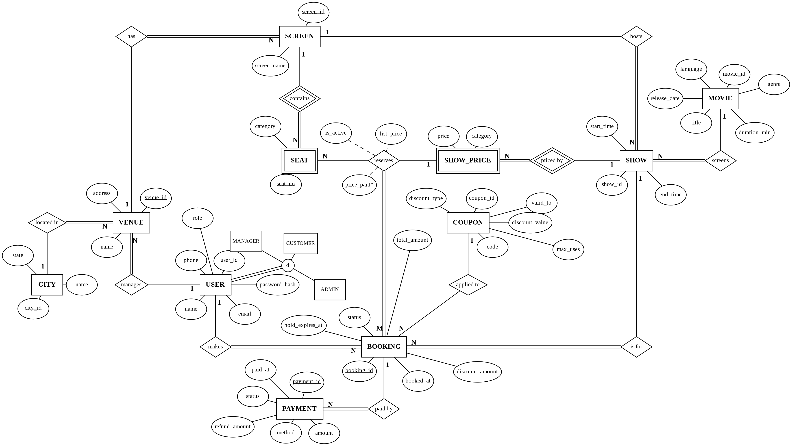

# CineBook: Movie Ticket Booking System

**CS F212 Database Systems (Sem 1, 2026-27), BITS Pilani, Hyderabad Campus | Group-17**

CineBook is a full-stack, database-backed movie ticket booking system in the style of BookMyShow. Customers search shows, hold seats, pay and cancel; venue managers schedule shows and set prices; admins view revenue and occupancy dashboards. The focus of the project is relational database design and DBMS-level integrity (for example, a seat can never be sold twice, enforced by the database itself). The application layer exists to demonstrate the design.

## Team

| Member | Student ID | Contribution |
|---|---|---|
| Pratham Singla | 2024A8PS0486H | Core database design: ER/EER model, relational mapping, keys and integrity constraints, normalization, design justification, booking transaction and concurrency design; Phase 1 SQL build-out |
| Harinandha L | 2024A4PS0660H | Requirements analysis, users, assumptions and business rules |
| Imran Hafeez S | 2024A4PS0690H | Application design: workflows, technology stack, architecture |
| Arjun Rathore | 2024A4PS0691H | GitHub repository setup, README, data-population plan |
| Sushanth Reddy Kompally | 2024A8PS0459H | Planned SQL queries, views and reporting design for the admin dashboard |

## Current Progress

| Item | Status |
|---|---|
| Requirements, assumptions, business rules | Done |
| ER/EER model and relational mapping | Done |
| Integrity constraints, normalization, design justification | Done |
| Application design, technology stack, architecture | Done |
| Phase 1: DDL, triggers, stored procedures (`db/00` to `db/04`) | Done |
| Indexes, read views, hold-expiry and failed-payment procedures (`db/05`) | Done |
| Phase 2: seed data (about 10,000 rows) and W3 constraint test log (38 tests, all passing) | Done |
| Phase 3: backend REST API (auth, bookings, shows, manager, admin) | Done |
| Phase 4: React front end (customer, manager, admin) | Done |
| Phase 5: Docker Compose integration, integration and load tests, `EXPLAIN ANALYZE` comparison | Done |
| Phase 6: final report and demo | Planned |

The full design document (5 pages) is in [`docs/CineBook_MidSem_Report.pdf`](docs/CineBook_MidSem_Report.pdf). Phase notes (handover, viva preparation, test write-up) are in `docs/phases/`, and the Phase 5 results and performance comparison are in [`docs/phase5/`](docs/phase5/).

## Database Design Summary



The diagram is a conceptual ER/EER model in Chen notation (foreign keys are not drawn). USER is specialised into CUSTOMER, MANAGER and ADMIN and mapped to one table with a `role` attribute. The ternary relationship `reserves` (BOOKING M, SEAT N, SHOW_PRICE 1) carries `list_price`, `price_paid` and `is_active`, and is mapped to the relation `booking_seat`.

**13 relations:** `app_user`, `city`, `venue`, `screen`, `seat` (weak), `movie`, `movie_show`, `show_price` (weak), `coupon`, `booking`, `booking_seat`, `payment`, `booking_audit`. The tables are named `app_user` and `movie_show` because USER and SHOW are reserved words.

**Key integrity decisions**

- **No double booking:** a partial unique index on `booking_seat (show_id, screen_id, seat_no) WHERE is_active`. Cancelled or expired bookings keep their history but free the seat.
- **Consistency across relations:** four composite foreign keys in `booking_seat` guarantee that the booking, the show, the seat (with its category) and the show's price for that category all match.
- **No overlapping shows:** an exclusion constraint on `movie_show` (same screen, overlapping time range), using PostgreSQL's `btree_gist` extension.
- **Pricing and discounts:** each reserved seat stores `list_price`, a snapshot of the show's price for the seat's category. The coupon discount is computed when the coupon is applied (`booking.discount_amount`, and `total_amount` is the amount payable). `price_paid` stays NULL until payment succeeds, then `CHECK (0 <= price_paid <= list_price)`. Refunds are recorded in `payment.refund_amount`.
- **Domain rules:** `PRIMARY KEY`, `FOREIGN KEY`, `UNIQUE`, `NOT NULL` and `CHECK` constraints on roles, statuses, prices, durations and time order. Rules a CHECK cannot express (1 to 6 seats per booking, manager role, audit log, confirmation rule, show must be in the future) use triggers and booking procedures.
- **Normalization:** the write model is normalized. The documented exceptions are `booking_seat` (repeats `show_id` and `screen_id` so the double-booking rule is enforced declaratively) and the sale-time snapshot columns. `total_amount` is derived. Details are in Section 6 of the PDF.

### Read-path design (API performance)

Showing one ticket should not need joins across user, booking, booking seat, seat, show, movie and venue. So `booking_seat` is a self-contained ticket line (seat number, category, list price, price paid), and `booking` stores a write-once snapshot of the show details (`movie_title`, `venue_name`, `screen_name`, `show_start`), like an invoice. The user comes from the JWT. Ticket detail is then one primary-key lookup plus one small range scan, and "my bookings" is one index scan on `(user_id, booked_at DESC)` with no joins. This is exposed as the view `v_ticket`. Joins and aggregates are reserved for admin reports. The `EXPLAIN ANALYZE` comparison of the naive join and the snapshot query is in `docs/phase5/EXPLAIN_COMPARISON.md`.

## Application Design

Architecture: **Front End <-> Backend <-> PostgreSQL**. Business-critical rules live in the database (constraints, triggers, procedures); the backend orchestrates transactions.

| Layer | Technology |
|---|---|
| Front end | React with Vite |
| Backend | Node.js with Express, REST API, JWT authentication, bcrypt, node-postgres (parameterised SQL, no ORM) |
| Database | PostgreSQL (`btree_gist` extension) |
| Tooling | Docker Compose, Python Faker for sample data, Git/GitHub |

### Workflows

1. **Book tickets (transaction):** search shows, choose seats, hold (list price copied from the show's price), apply coupon, pay, confirm (`price_paid` set). Rollback if payment fails; cancellation with refund.
2. **Admin analytics (complex retrieval):** revenue per venue per month, occupancy per show, top movies per city and peak booking hours, using joins, aggregation, subqueries, CTEs and views.
3. **Schedule show / invalid operations (constraint enforcement):** a manager schedules a show and sets per-category prices from the UI (both inserts in one transaction). An overlapping show, a double booking, more than 6 seats, a bad price and an expired coupon are attempted and rejected by the DBMS. The 38-test SQL log is in `db/tests/w3_tests.sql`; the overlapping-show rule is also tested through the API in `backend/tests/integration_test.mjs`.

## Repository Layout

```
.
|-- README.md
|-- docker-compose.yml          # db + backend + frontend (+ seed, run on demand)
|-- .env.example                # copy to .env
|-- PHASE5_RUN_GUIDE.md         # short run guide
|-- docs/
|   |-- CineBook_MidSem_Report.pdf
|   |-- er_diagram.png
|   |-- w3_test_log.txt         # saved output of db/tests/w3_tests.sql
|   |-- phase 1/ ... phase 3/   # handover, viva notes, test write-ups
|   `-- phase5/                 # PHASE_5_RESULTS.md, EXPLAIN_COMPARISON.md
|-- db/
|   |-- 00_extensions.sql       # btree_gist
|   |-- 01_tables.sql           # 13 tables
|   |-- 02_constraints.sql      # CHECKs and the exclusion constraint
|   |-- 03_triggers.sql         # 5 triggers (the 6th is in 05)
|   |-- 04_procedures.sql       # sp_create_booking, sp_confirm_booking, sp_cancel_booking
|   |-- 05_indexes_views.sql    # indexes, sp_expire_holds, sp_record_failed_payment, 6 views
|   |-- setup.sh                # manual (non-Docker) schema setup
|   |-- seed/                   # generate_seed_data.py, requirements.txt, Dockerfile
|   `-- tests/
|       |-- smoke_test.sql      # needs an empty database
|       |-- step1_test.sql      # needs an empty database
|       |-- w3_tests.sql        # works on empty or seeded database
|       `-- explain_comparison.sql   # naive vs snapshot EXPLAIN ANALYZE (read-only)
|-- backend/                    # Node/Express API (src/, tests/, Dockerfile)
`-- frontend/                   # React + Vite app (src/, Dockerfile, nginx.conf)
```

## Setup and Run (Docker)

Requirements: Docker Desktop (with Compose). Node.js 22+ is only needed for the optional tests. Verified on macOS with Docker Desktop.

**1. Configure.** Copy the example environment file and (optionally) set a long random `JWT_SECRET`.
```
cp .env.example .env
```

**2. Start everything.** Make sure nothing else is using ports 5432, 5050 and 8080 (for example a local PostgreSQL). On the first start with an empty volume, PostgreSQL runs `db/00` to `db/05` automatically.
```
docker compose up --build -d
docker compose ps
```
Wait until `db` shows `healthy`.

**3. Seed the data once** (about 10,000 rows).
```
docker compose run --rm seed
```

**4. Open the app** at http://localhost:8080 (API at http://localhost:5050/api).

| Role | Login | Password |
|---|---|---|
| Customer | `customer1@cinebook.test` to `customer40@cinebook.test` | `Password@123` |
| Manager | `manager1@cinebook.test` to `manager10@cinebook.test` | `Password@123` |
| Admin | `admin@cinebook.test` | `Password@123` |

- Customer: Movies, pick seats, optional coupon (for example `WELCOME10`), pay, My Bookings, cancel.
- Manager: Manager Dashboard (shows, occupancy, revenue) and Schedule Show (movie, screen, start time, prices).
- Admin: Admin Dashboard (revenue, occupancy, top movies, peak hours) and cities, venues, screens and movies.

**5. Tests** (optional).
```
cd backend
node tests/integration_test.mjs                  # 30 checks through the real API
node tests/load_test.mjs /shows 20 300           # load test
node tests/load_test.mjs /shows/1/seats 20 300
cd ..
docker compose exec -T db psql -U postgres -d cinebook < db/tests/w3_tests.sql
docker compose exec -T db psql -U postgres -d cinebook < db/tests/explain_comparison.sql
```
The integration test creates temporary accounts and one future show on each run. `smoke_test.sql` and `step1_test.sql` insert their own "Hyderabad" city and need an empty database (see `docs/phase5/PHASE_5_RESULTS.md` for a temporary-database recipe).

**6. Stop.** `docker compose down` keeps the data. `docker compose down -v` **deletes the database**.

**Notes**
- Docker only runs the SQL files the first time the data volume is created. After editing a `db/*.sql` file, run `docker compose down -v` and start again.
- Local development without Docker: run the database scripts with `db/setup.sh`, then `npm install && npm run dev` in `backend/` and `frontend/` (front end on http://localhost:5173).

## Timeline

| Date | Milestone |
|---|---|
| 11 Oct 2026 | Mid-sem submission (design document, application design, repository) |
| 15 Nov 2026 | Final submission |
| 17-19 Nov 2026 | Final demo and viva |
